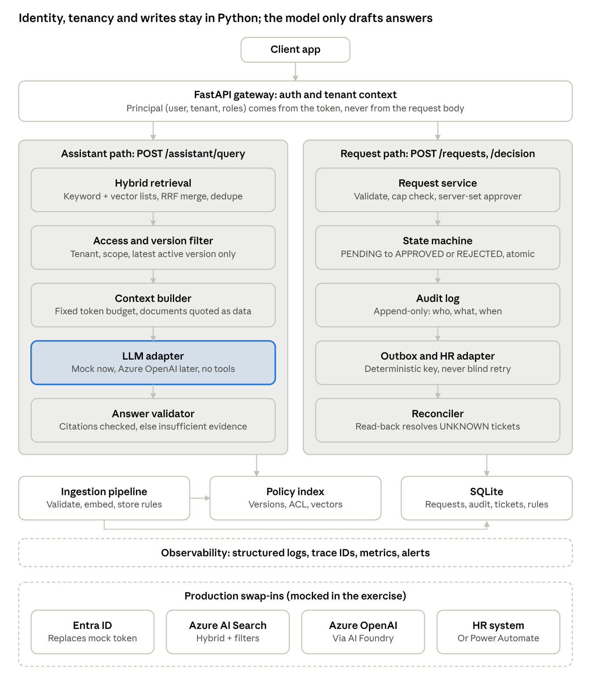
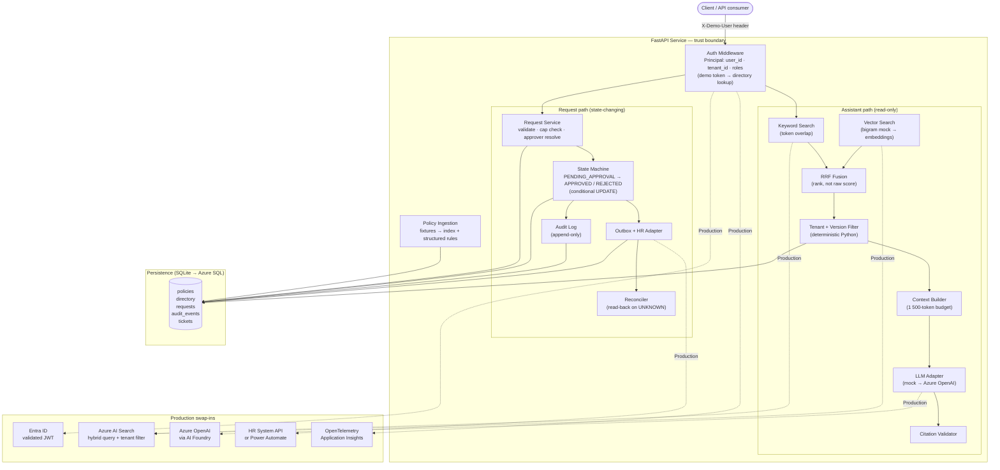

# Enterprise Policy Assistant — Architecture

**Prepared by:** Rajesh Patnam · Hands-on AI / Python Engineering Lead assessment  
**Version:** 1.1 · 10 November 2026

---

## System diagram



### Mermaid source (renders on GitHub / VS Code)



---

## Two request paths

| Concern | Assistant path | Request path |
|---|---|---|
| Nature | Read-only, language task | State-changing, business task |
| Cost of failure | Wrong or leaked answer | Wrong approval, duplicate ticket |
| Control style | Filter → ground → validate | Constrain → authorize → record |
| Role of LLM | Writes the answer from cited evidence | None |

---

## Component summary

| Component | Exercise | Production |
|---|---|---|
| API service | FastAPI (Python 3.11+) | FastAPI on Azure Container Apps |
| Authentication | Demo token → directory fixture | Entra ID, validated JWT claims |
| Policy ingestion | Script loading fixtures | Pipeline into Azure AI Search |
| Keyword retrieval | In-memory token overlap | Azure AI Search keyword index |
| Vector retrieval | Bigram mock | Azure AI Search vector index |
| LLM | Mock adapter | Azure OpenAI via AI Foundry |
| Persistence | SQLite | Azure SQL or PostgreSQL |
| HR integration | In-process mock | HR system API or Power Automate |
| Audit / monitoring | Structured JSON logs | OpenTelemetry → Application Insights |

---

## Key security decisions

| Scenario | Design decision |
|---|---|
| Cross-tenant leakage | Tenant filter in search query **and** Python re-filter — both must pass |
| Stale policy leakage | `active=True` filter + "highest version per family" rule in Python |
| Unauthorized approval | Designated-approver check; conditional UPDATE; 404 hides existence |
| Prompt injection | Retrieved text wrapped as `[EVIDENCE]` data; LLM has no tools; citations validated |
| Duplicate ticket | Outbox row + idempotent `external_ref`; UNKNOWN → reconcile, never blind retry |

---

## Azure services vs deterministic Python

| Concern | Approach |
|---|---|
| Semantic + keyword search with tenant filtering | Azure AI Search — hybrid query with mandatory `tenant_id` and `active` filters |
| Answer synthesis | Azure OpenAI through Azure AI Foundry |
| Multi-step assistance (retrieve, compare, draft) | Foundry Agent Service or LangGraph with **read-only** tools |
| Identity, tenancy, access scope, version precedence | Python — never delegated to a model |
| Entitlement and cap checks | Python using structured `rules` stored with each policy |
| Idempotency, state machine, approvals, audit | Python + database constraints |
| Ticket creation and reconciliation | Python outbox pattern |

### Power Automate integration (without weakening authorization)

The API creates the request and publishes an approval-needed event.  
A Power Automate flow collects the approval (approver signed in via Entra ID), then calls `POST /requests/{id}/decision` with:

1. A **service identity token** proving the flow itself is authorised.  
2. The **approver's on-behalf-of token** so the API can verify the designated approver.  
3. An **idempotency key** built from `{request_id}:{flow_run_id}`.

The API re-checks all invariants. The flow's approval output is not trusted on its own.

---

## Repository layout

```
enterprise-policy-assistant/
├── app/
│   ├── main.py          # FastAPI app, middleware, 3 endpoints
│   ├── auth.py          # Principal, demo token → directory
│   ├── db.py            # SQLite schema, get_conn()
│   ├── ingestion.py     # Policy + directory fixtures
│   ├── retrieval.py     # keyword_search, vector_search, RRF, filter
│   ├── llm.py           # LLMAdapter protocol + MockLLMAdapter
│   ├── rag.py           # context builder, citation validator, answer_query()
│   ├── workflow.py      # create_request(), decide_request(), state machine
│   ├── integrations.py  # HRAdapter, attempt_ticket(), reconcile_ticket()
│   └── models.py        # Pydantic models
├── tests/
│   ├── conftest.py
│   ├── test_tenant_isolation.py
│   ├── test_policy_version.py
│   ├── test_evidence_handling.py
│   ├── test_idempotency.py
│   ├── test_approval_authorization.py
│   ├── test_repeated_decision.py
│   └── test_external_timeout.py
├── docs/
│   └── architecture.md   ← this file
├── README.md
└── requirements.txt
```
